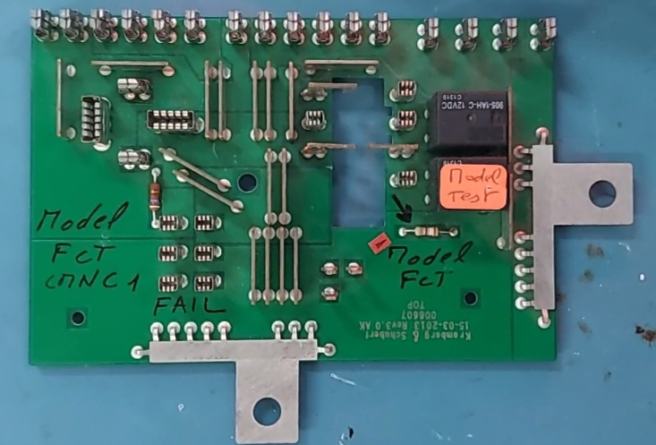
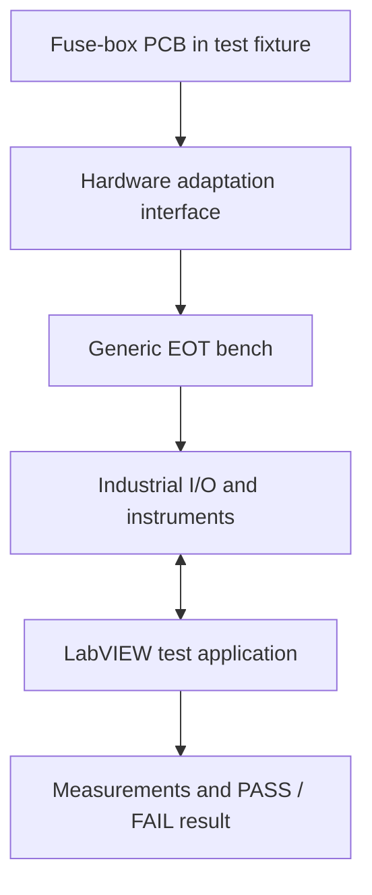

# Automotive Fuse Box PCB: FCT-to-EOT Test Migration

**Industrial functional test automation | LabVIEW | Hardware–software integration**

> An engineering graduation project completed in an industrial setting. This repository documents the approach and outcomes; proprietary schematics, production software, and customer data are not published.

## Overview

This project consists of rewiring the test system of a fuse box PCB to fit a new test bench, preserving some of its old elements while ensuring that all tests are performed using the new bench.

This work combines an adaptation of the test interface, the integration of new instruments and I/O, and a new LabVIEW application to automate the testing process.

## Engineering challenge

The original setup relied on an older, product-specific test architecture. Moving testing to a generic EOT bench required aligning the existing fixture with a different connector and I/O configuration, coordinating measurement resources, and translating the test sequence into a new software architecture.

Key objectives:

- Adapt the existing fixture to the EOT resources without redesigning the product under test.
- Reimplement the required functional measurements in LabVIEW.
- Provide separate workflows for production, troubleshooting, and reference-unit validation.
- Reduce execution time while preserving test coverage.
  

## System architecture

The following high-level diagram is intentionally simplified for public documentation.

### Hardware integration

An adaptation interface bridged the pre-existing fixture and the generic bench connector arrangement. The EOT environment included industrial digital I/O, switching resources, power supplies, and digital multimeters. The software coordinated these resources to apply stimuli and acquire measurements.

### LabVIEW application

The application supported three operating modes:

| Mode | Purpose |
| --- | --- |
| **Production** | Execute the automated functional test sequence and present the final result. |
| **Debug** | Inspect individual steps and measurements during troubleshooting. |
| **Golden** | Support checks using a known-good reference unit. |

## Functional verification

The migrated sequence covered the following groups of checks:

| Test group | Scope |
| --- | --- |
| Continuity and short-circuit checks | 11 block-level tests |
| Relay contact tests | 2 tests |
| Resistance measurements | 2 tests |

## Outcome

- Implemented a functional test workflow on the generic EOT bench.
- Integrated hardware adaptation with the LabVIEW-controlled measurement sequence.
- Added dedicated Production, Debug, and Golden operating modes.
- **Reduced the test cycle time by more than 50%** compared with the previous workflow, based on project validation.

## Technologies and skills

`LabVIEW` · `Functional Circuit Testing` · `End-of-Line Testing` · `Industrial I/O` · `Modbus TCP/IP` · `Digital Multimeters` · `Power Supplies` · `Hardware Integration` · `Test Automation` · `Troubleshooting`

## Project context

Graduation engineering project carried out at **Eleonetech (OneTech Group)**. The descriptions here reflect the author's engineering work and are provided for portfolio purposes, not as an official company reference or a complete reproducible production implementation.

## Related project

An external **EOT Bench Self-Test System** was also developed to diagnose test-bench resources before product testing. It is documented separately in the portfolio.

---

**Author:** Roua Sebii · Embedded Systems Engineer
